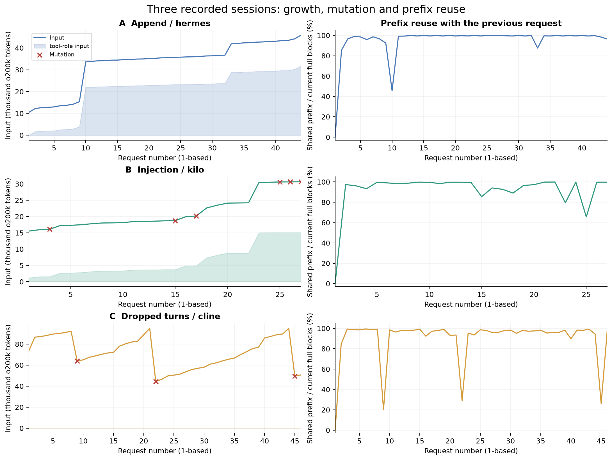
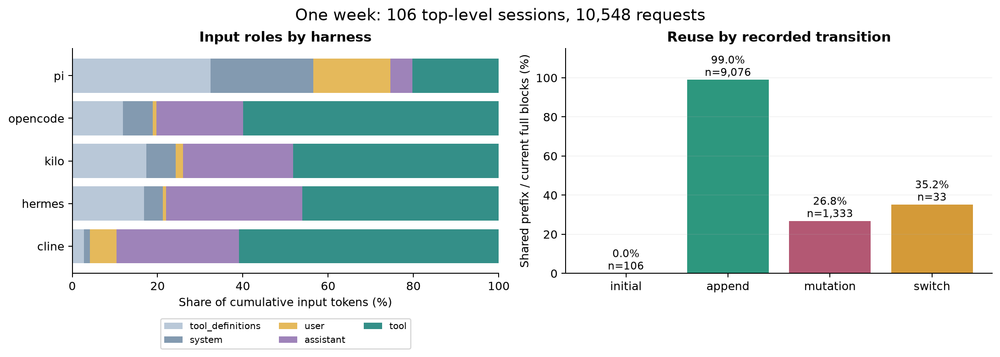
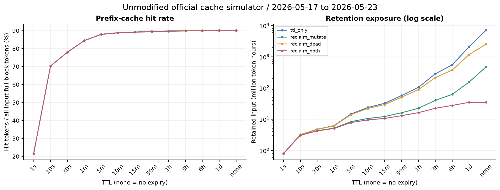

# FreeInference：会话结构、上下文增长与前缀缓存

[仓库首页](../../README.md) · [完整分析报告](report/README.md) · [官方缓存结果](report/official-simulation-summary.csv) · [复现说明](report/REPRODUCE.md)

三条真实会话，共 117 次模型请求，分别展示持续追加、注入改写和删除历史轮次。每条保留原始记录、完整缩进 JSON、阅读用 JSON 和逐请求表。

**来源没有发布用户问题、模型回答或工具结果正文。** 可以阅读模型请求、匿名化工具调用骨架、结果 token 数和上下文变化；不能从这些记录恢复完整任务内容。

## 三条会话

| 变化方式 | harness | 请求数 | 输入 token：初始 → 末次 / 峰值 | 阅读入口 |
|---|---|---:|---|---|
| 持续追加 | hermes | 44 | 10,421 → 45,790 / 45,790 | [逐轮表](01-append/README.md) · [阅读 JSON](01-append/requests.json) · [完整 JSON](01-append/trace.json) · [CSV](01-append/requests.csv) |
| 注入改写 | kilo | 27 | 15,531 → 30,651 / 30,651 | [逐轮表](02-injection/README.md) · [阅读 JSON](02-injection/requests.json) · [完整 JSON](02-injection/trace.json) · [CSV](02-injection/requests.csv) |
| 删除历史轮次 | cline | 46 | 73,397 → 50,639 / 94,984 | [逐轮表](03-dropped-turns/README.md) · [阅读 JSON](03-dropped-turns/requests.json) · [完整 JSON](03-dropped-turns/trace.json) · [CSV](03-dropped-turns/requests.csv) |

一行对应一次模型请求：已有上下文 → 模型响应产生工具调用 → 工具结果 → 可能进入下一次请求。同一用户轮次可以包含多次模型请求。

- `trace.raw.json`：来源中的原始记录。
- `trace.json`：完整缩进版，字段和数组与原始记录一致。
- `requests.json`：方便阅读的逐请求副本，附加统计指标；很长的 block_ids 数组在此文件中替换为明确标注的摘要，完整数组仍在 trace.json。
- `README.md` / `requests.csv`：全部请求按来源顺序排列，展开可查看匿名化参数和观察元数据。

## 一周分析结果

先对本地单日数据作描述性分析，再扩展到 2026-05-17—23 并实际运行未修改的官方缓存模拟。

| 指标 | 一周结果 |
|---|---:|
| 顶层会话 / 模型请求 / 工具调用 | 106 / 10,548 / 11,045 |
| tool 角色占累计输入 | 56.66% |
| 相邻请求共享前缀占完整块输入 | 89.89% |
| 同会话历史已见块占完整块输入 | 89.98% |
| 会话峰值 / 初始输入，中位数 | 2.76× |
| 官方模拟 | 4 种策略 × 13 个 TTL |

5 分钟 TTL 下，仅按已到达请求的改写信号回收缓存（官方 reclaim_mutate），保留量按 token×时间累计减少 **43.06%**，命中率下降 **0.016 个百分点**。这支持继续研究缓存回收；不意味着能从模型上下文中安全删除相同比例的内容。

部分框架把工具观察放在 user 等角色中，tool 角色占比不能完整代表所有工具结果。块复用还包含系统提示和工具定义。统计口径、回收策略、模型假设及限制均见[完整报告](report/README.md)。

## 图表

### 三条会话的增长、改写与前缀复用

[PDF](report/figures/01-three-sessions.pdf)

### 一周的角色构成与不同变化下的复用

[PDF](report/figures/02-week-overview.pdf)

### 官方模拟的命中率与缓存保留量

[PDF](report/figures/03-official-cache.pdf) · [全部模拟结果 CSV](report/official-simulation-summary.csv)

## 来源与范围

数据：[HarvardMadSys FreeInference Agentic Trace](https://huggingface.co/datasets/harvardMadsys/freeinference_agentic_trace)，来源许可为 [CC BY 4.0](https://creativecommons.org/licenses/by/4.0/)。官方分析与模拟代码：[HarvardMadSys/freeinference_agentic_trace](https://github.com/HarvardMadSys/freeinference_agentic_trace)。固定版本、样本 ID、原始数据与输出校验值见[报告](report/README.md)及[运行记录](report/reproduction.json)。

三条会话按变化方式选取，用于展示结构；一周统计覆盖全部顶层 Agentic 会话，不含 19 个嵌套子会话。不新增大模型调用、不执行记录中的工具、不进行语义压缩准确率实验。阅读版新增索引、排版和派生指标，来源内容保留原归属。
